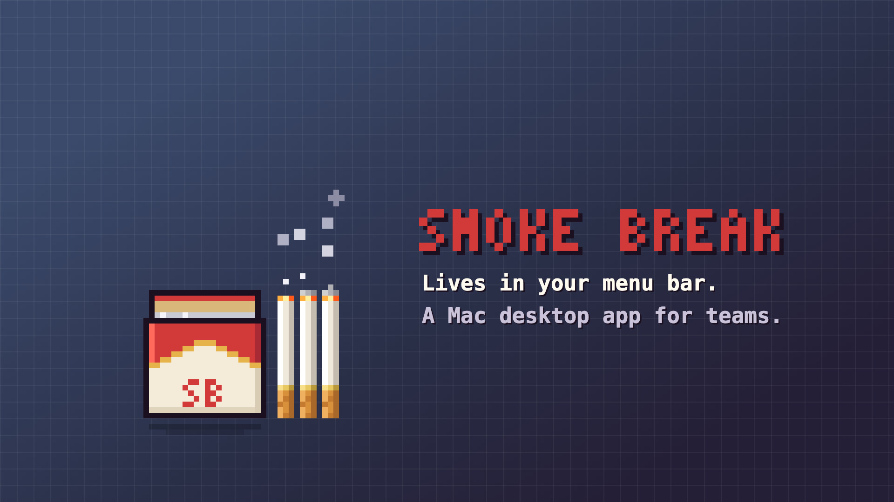

# Smoke Break

A little pixel-art pack of cigarettes that floats on your desktop and gets your team on a break together.

Click the pack to invite your team. When a second person joins, a lighter appears. Light up and everyone's Zoom call opens. Your cigarette then burns down as the break timer (10–15 minutes).

Not a smoker? Pick another **break style**:

- **Water:** a water cooler. You fill a cup instead of lighting up, and the jug drains as the timer.
- **Coffee:** a coffee maker pours everyone a mug, and the pot drains as the timer.
- **Donut:** a bakery box of donuts. Yours gets sprinkles, then gets eaten bite by bite as the timer.

Styles and skins are personal. Everyone shares the same break, but each person sees their own style.

[](brag-output/brag.mp4)

> **Status:** working prototype. The desktop app has only been built and tested on macOS. Windows and Linux are tracked in [#1](https://github.com/DementedEarplug/smoke-break/issues/1).

## How it works

Smoke Break has two parts:

- **The app** is the floating pack on each person's screen. It's a desktop overlay built with [Tauri](https://tauri.app) that sits on top of your other windows. Clicks on the empty space around the pack go straight through to whatever is underneath. There's also a browser version of the pack for testing.
- **The hub** is a small server that everyone's app connects to. It keeps track of teams and runs the break timer, so everyone sees the same break at the same time.

For development, one command starts both on your computer. For a team on different computers, the hub has to run somewhere everyone can reach. See [Hosting a hub for your team](#hosting-a-hub-for-your-team).

## Requirements

- [Node.js](https://nodejs.org) 22.18 or newer.
- For the desktop app: Rust and Tauri's system dependencies. See [Tauri's prerequisites](https://v2.tauri.app/start/prerequisites/). On macOS that means the Xcode Command Line Tools and `rustup`.

## Quick start

### Desktop app

```sh
npm install
npm run desktop
```

This starts a hub on your computer and opens the app. The first time, the **Settings** window opens: enter your name, then start a team or join one with an invite code. After that, the pack floats in the bottom-right corner of your screen.

The app lives in the menu bar and has no Dock icon. The menu-bar icon has **Settings…**, **Do not disturb**, **Launch at login** and **Quit**.

### Browser version

```sh
npm install
npm run dev
```

Open http://localhost:5173 and start a team. To try a break by yourself, click **Open a teammate tab**. Each tab acts as a separate person.

### Demo mode

`npm run demo` (browser) and `npm run desktop:demo` (desktop) shrink a break "minute" to 3 seconds, so a 12-minute break takes 36 seconds.

## Setting up your team

1. **Start a team.** You become its **owner**. Only the owner can change the team's settings, let people in and remove them.
2. **Add your Zoom link.** In the team panel, open **Settings** and paste the team's Zoom meeting link. It must be an `https://` link on `zoom.us`, `zoom.com` or `zoomgov.com`, because it opens automatically on everyone's computer when a break starts.
3. **Invite people.** Share the invite code (desktop) or invite link (browser) from the team panel. Teammates enter it the first time they open the app.
4. **Let them in.** Someone with the right code doesn't join straight away. They show up under **waiting** in your team panel, and you let them in or turn them away. Someone turned away can't ask that team again for a day. You can switch approval off in Settings so the code alone is enough, unless the hub runs in strict mode.
5. **Pick a default break length** in Settings (10–15 minutes). Whoever starts a break can still change it before anyone joins.

The team panel lists everyone on the team, online or not. Names stay reserved while their owners are offline. As the owner you can also:

- **Remove** someone. This also replaces the invite code, so they can't simply rejoin.
- **Change the invite code** at any time.
- **Hand the team over** to another member.

Everyone on a team must connect to the same hub. On a single computer that happens automatically.

## Using the pack

- **Click the pack** to start a break, or to join one someone else started.
- **Scroll on the pack**, or use the − and + buttons, to change the length before anyone joins.
- **Click the lighter** to light up. Your cigarette comes out of the pack, catches in the flame and lands beside the pack, then Zoom opens.
- **Click your own cigarette** to put it back before lighting, or to stub it out early.
- **Drag** the pack to move it. **Right-click** it to turn do-not-disturb on or off.
- **Pinch** (or ⌃-scroll) on the pack to resize it.

The **My pack** panel lets you change the size, the pack and lighter skins, and the **break style** (Smoke, Water, Coffee or Donut). On desktop it's in the Settings window; in the browser it's next to the team panel. These choices stay on your device and never change what teammates see.

## Hosting a hub for your team

When teammates are on different computers, run the hub on a machine they can all reach, such as a small server, behind HTTPS. The full setup is in **[docs/hosting.md](docs/hosting.md)**: access tokens, the HTTPS proxy, running it as a service, building the app for your hub, and day-to-day admin.

> **Don't use the dev server as your team's hub.** `npm run dev` and `npm run share` run a hub inside the development server. They use plain, unencrypted HTTP and serve the project's files. They're fine on a network you trust, but don't expose them to the internet or put a tunnel in front of them.

For a quick test on your own network, `npm run share` serves the browser version and a hub. Set `SMOKE_BREAK_PUBLIC_HOST` to the address teammates will open, for example `SMOKE_BREAK_PUBLIC_HOST=192.168.1.20 npm run share`. Without it, only pages opened on `localhost` can connect.

## Security

In short:

- **Only people you give an access token to can connect.** The hub checks the token before it accepts a connection. With one token per person, deleting someone's token cuts them off within seconds.
- **Knowing the invite code isn't enough to join.** The team owner approves each new person, and removing someone removes all of their devices.
- **Only Zoom meeting links are allowed**, and both the hub and each app check them before anything opens. Only people in a break receive its link.
- **Nobody can pose as someone else.** Each device has a private ID that teammates never see, and names can't be copied with lookalike letters.
- **The hub limits** message sizes, connections and how often people can change things, so one person can't overwhelm it.
- **The Mac app** stores its token in the Keychain and can only connect to your hub when built with `npm run desktop:build:enterprise`.

What the hub defends against, and what it doesn't, is in [docs/hosting.md](docs/hosting.md#security-model). Signing and shipping the Mac app is in [src-tauri/SIGNING.md](src-tauri/SIGNING.md).

## Development

```sh
npm test            # hub, protocol and break tests
npm run typecheck
npm run build       # browser build into dist/
```

During development the hub runs inside the Vite dev server (see `vite.config.ts`), so `npm run dev` and `npm run desktop` need nothing else.

| Path | What it holds |
| --- | --- |
| `shared/protocol.ts` | Messages, types and validation shared by the apps and the hub |
| `server/breakMachine.ts` | The break state machine: idle → pending → lighter → lit → out |
| `server/hub.ts` | The hub: teams, rosters, approvals, invite codes, timers, identity and limits |
| `server/persistence.ts` | The saved team file: format, upgrades from older hubs, safe writes |
| `server/accessTokens.ts` | Shared and per-person access tokens |
| `server/addresses.ts` | Client addresses, trusted proxies, Host and Origin checks |
| `server/audit.ts` | The audit log |
| `server/names.ts` | Display names: cleanup and lookalike-proof comparison |
| `server/admin.ts` | Admin commands: list teams, print a code, reassign an owner, lift bans, delete a team |
| `server/limits.ts` | Rate limiters used by the hub |
| `server/meeting.ts` | Meeting providers (a fixed Zoom link for now) |
| `server/main.ts` | The standalone hub (`npm run server`) |
| `src/widget/` | The floating pack: sprites, animation, speech bubble, input |
| `src/widget/skins.ts` | Pack and lighter skins |
| `src/widget/theme.ts` | Break style names and their wording |
| `src/widget/styles/` | Each break style's look and animation |
| `src/appearance.ts` | Your size, style and skin choices, synced across your windows |
| `src/overlay.ts` | The desktop overlay window: click-through, dragging, menu-bar sync |
| `src/panel.ts` | The desktop Settings window |
| `src/main.ts` | The browser version: a fake desktop plus the team panel |
| `src/shell.ts` | Onboarding, team panel and settings, shared by both versions |
| `src-tauri/` | The Tauri app: windows, menu-bar icon, launch at login |
| `scripts/make-icons.ts` | Renders the app and menu-bar icons from the pack sprites |
| `brag-output/` | The promo video and the scripts that make it |

## License

[MIT](LICENSE)
